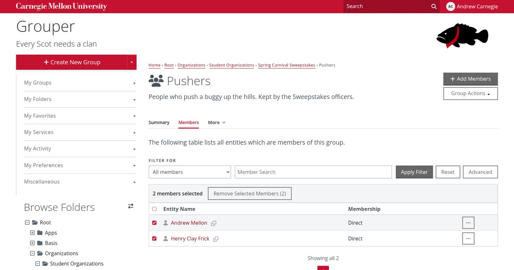

# Kith & Kirr

Kith & Kirr, named for Kirr Commons and "kith and kin," is Carnegie Mellon's
look for [Grouper](https://incommon.org/software/grouper/)'s web UI: the red
roof with the CMU wordmark, your site's name, the template's footer, and the
Web Kilt's colors, type, tables, forms and buttons on every screen where
people manage groups and their members.

Docs: https://themes.andrew.cmu.edu/kith-and-kirr/

## Install

Download `kith-and-kirr.zip` from the
[latest release](https://github.com/cmu-web/cmu-web-kith-and-kirr/releases/latest)
and copy its files into Grouper's own places for a site's additions:

| From the zip                                    | Into Grouper's web app (`/opt/grouper/grouperWebapp` in the container)       |
| ----------------------------------------------- | ---------------------------------------------------------------------------- |
| `assets/kith-and-kirr/`                         | `grouperExternal/public/assets/kith-and-kirr/`                               |
| `customHeader.jsp`                              | `WEB-INF/grouperUi2/assetsJsp/customHeader.jsp` (empty in Grouper)           |
| `properties/grouper-ui.properties`              | Add its lines to `WEB-INF/classes/grouper-ui.properties`                     |
| `properties/grouper.text.en.us.properties`      | Add its lines to `WEB-INF/classes/grouperText/grouper.text.en.us.properties` |
| `properties/Owasp.CsrfGuard.overlay.properties` | Add its line to `WEB-INF/classes/Owasp.CsrfGuard.overlay.properties`         |

Then restart Grouper. [Deployment](DEPLOYMENT.md) has the details: in a
container, the CSRFGuard line and why it matters, and what to set for your
site's name.

## What It Changes and What It Doesn't

The theme changes how Grouper looks and the words on its buttons, menus and
headings, never what Grouper does. It uses only the places Grouper sets aside
for a site: the empty `customHeader.jsp`, Grouper's settings files for a
site's own values and a folder of its own under Grouper's public assets.
Nothing of Grouper's is replaced or edited, so a Grouper upgrade keeps the
theme. Text Grouper shows through its `grouper:message` tag (the group
summary's labels, for one) changes only after a restart.

## Demo

`demo/groups.yaml` is a made-up Grouper structure for Buggy, the Spring
Carnival Sweepstakes, with made-up people. `make run` runs Grouper with the
theme and loads it; see [Development](DEVELOPMENT.md).
